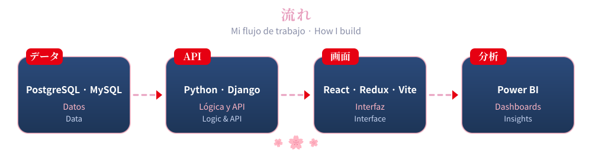

<!-- ───────────── HEADER ───────────── -->

 

<!-- ───────────── ABOUT ───────────── -->

  

 

<table align="center">
<tr>
<td rowspan="2" width="34%" align="center" valign="middle">
  
</td>
<td valign="top">

**🇪🇸 Español**

¡Hola! Soy **Desarrolladora de Software y Analista de Datos** con **más de 2 años de experiencia en backend** y un fuerte enfoque en frontend. Me encanta combinar **diseño, lógica y datos** para crear soluciones limpias, útiles y con impacto.

🔹 **Backend:** APIs y sistemas robustos con **Python + Django**.
🔹 **Frontend:** interfaces rápidas y amigables con **React, Redux y Vite**.
🔹 **Datos:** actualmente trabajo como **Analista de Datos**, creando dashboards interactivos y aplicaciones web para decisiones basadas en datos.
🔹 **Competencias:** he participado en competencias de programación y siempre estoy lista para un nuevo reto.

</td>
</tr>
<tr>
<td valign="top">

**🇬🇧 English**

Hi! I'm a **Software Developer & Data Analyst** with **2+ years of backend experience** and a strong focus on frontend. I love mixing **design, logic and data** to build solutions that are clean, useful and meaningful.

🔹 **Backend:** robust APIs and systems with **Python + Django**.
🔹 **Frontend:** fast, user-friendly interfaces with **React, Redux & Vite**.
🔹 **Data:** I currently work as a **Data Analyst**, creating interactive dashboards and web apps that support data-driven decisions.
🔹 **Competitions:** I've taken part in programming competitions and I'm always up for a new challenge.

</td>
</tr>
</table>

> 💬 *「継続は力なり」* — **La constancia es poder · Persistence is power.**

<!-- ───────────── QUICK FACTS ───────────── -->

  

 

| Enfoque Focus | Aprendiendo Learning | Abierta a Open to | Pregúntame sobre Ask me about |
|:--:|:--:|:--:|:--:|
| Full-stack + Datos Full-stack + Data | Power BI · C++ · Dart · Vue.js | Colaborar en open source Open-source collaboration | Desarrollo web · React · Python Web dev · React · Python |

<!-- ───────────── TECH STACK ───────────── -->

  

 

  

| | Área · Area | Tecnologías · Technologies |
|:--:|:--|:--|
| 🐍 | **Backend** Fortaleza principal · Main strength |  |
| ⚛️ | **Frontend** Mi día a día · Daily driver |  |
| 🗄️ | **Bases de datos** Databases |  |
| 📊 | **Datos y BI** Data & BI |  |
| 🛠️ | **Herramientas** Tools |  |

<!-- ───────────── LEARNING ───────────── -->

  

 

  

<!-- ───────────── PROJECTS ───────────── -->

  

<!-- ═════════ 壱 · DOZO ═════════ -->

<a href="https://dozo-iota.vercel.app/">
   
  
</a>

<!-- ═════════ 弐 · E-INVENTORY ═════════ -->

<a href="https://github.com/majopan/e-inventoy-frontend-">
   
  
</a>

<!-- ═════════ 参 · TONGARI BERRY ═════════ -->

 
 

 

<!-- ───────────── STATS ───────────── -->

  

 

 

  

  
 

  

<!-- ───────────── CONTACT ───────────── -->

  

 

**¿Colaboramos? · Let's build something together!**

  

  

